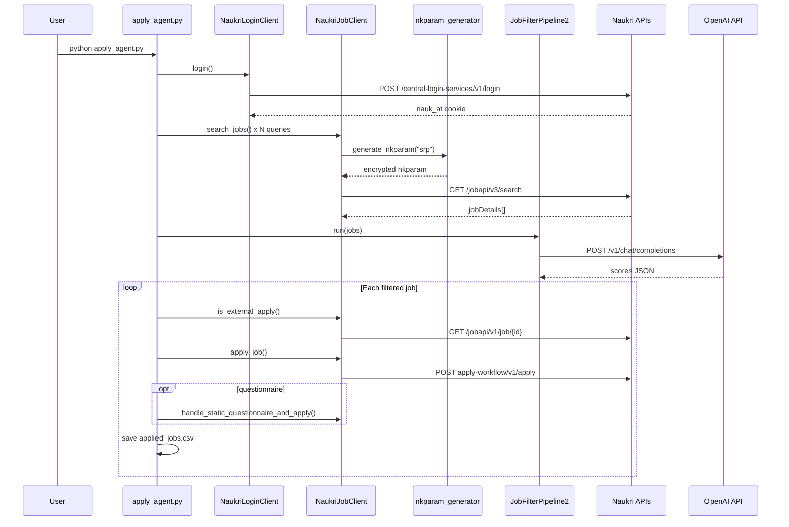

# 01 — Project Architecture

## Overview

NopeRi is a **headless HTTP client** for Naukri.com job-seeker APIs. It mimics browser requests using:

1. **`httpcloak.Session`** — Chrome TLS/JA3 fingerprint (`session.py`)
2. **Cookie-based Bearer auth** — `nauk_at` cookie → `Authorization: Bearer` header
3. **RSA-encrypted nkparam** — Required for search/job-details endpoints (`nkparam_generator.py`)

There is **no web server**, **no database layer in production path**, and **no package `__init__.py` files**. The architecture is script + library modules.

---

## Architectural Layers

```
┌─────────────────────────────────────────────────────────────────┐
│                     ENTRY POINTS (Scripts)                       │
│  main.py (demo)  │  apply_agent.py (AI agent)  │  updateDaily.py │
│                  │                              │  (legacy)       │
└────────┬─────────┴──────────────┬───────────────┴─────────────────┘
         │                        │
         ▼                        ▼
┌─────────────────────┐  ┌──────────────────────┐
│  NaukriLoginClient  │  │   NaukriJobClient    │
│  naukri_client.py   │◄─┤   job_client.py      │
│                     │  │                      │
│  • login/OTP        │  │  • search            │
│  • resume           │  │  • recommend         │
│  • profile          │  │  • apply             │
│  • history          │  │  • job details       │
└─────────┬───────────┘  └──────────┬───────────┘
          │                         │
          ▼                         ▼
┌─────────────────────────────────────────────────────────────────┐
│                    INFRASTRUCTURE / UTILITIES                    │
│  session.py │ constants.py │ request_helper.py │ extractors.py  │
│  nkparam_generator.py │ models.py │ exceptions.py               │
└─────────────────────────────────────────────────────────────────┘
          │
          ▼
┌─────────────────────────────────────────────────────────────────┐
│                    EXTERNAL SERVICES                             │
│  Naukri.com APIs │ filevalidation.naukri.com │ OpenAI API       │
│  (apply_agent)   │ Google Drive (updateDaily only)               │
└─────────────────────────────────────────────────────────────────┘
```

---

## Core Components

### 1. Session Layer — `src/client/session.py`

| Item | Detail |
|------|--------|
| **Function** | `build_session()` |
| **Returns** | `httpcloak.Session(preset="chrome-latest", timeout=30)` |
| **Purpose** | Single factory for all authenticated HTTP traffic |
| **Used by** | `NaukriLoginClient.__init__` |

**Design note:** File validation upload uses plain `requests.post` (not httpcloak session) in `_validate_file_request`.

---

### 2. Auth & Profile Layer — `src/client/naukri_client.py`

| Class | `NaukriLoginClient` |
|-------|---------------------|
| **State** | `session`, `naukri_session` (NaukriSession), `profile_id`, `cache` |
| **Responsibilities** | Login, OTP, formKey extraction, profile ID, resume upload, profile fields, application history |

All authenticated calls use `_build_headers(auth=True)` which injects `Authorization: Bearer {token}`.

---

### 3. Job Layer — `src/client/job_client.py`

| Class | `NaukriJobClient` |
|-------|-------------------|
| **Constructor** | `(login_client: NaukriLoginClient, use_pool: bool = False)` |
| **Shares** | `login_client.session` (same cookies/token) |
| **Responsibilities** | Parse jobs, search with nkparam, recommend, apply, questionnaires, external-apply check |

---

### 4. AI Filter Layer — `src/client/jop_classifier.py`

| Class | `JobFilterPipeline2` |
|-------|----------------------|
| **Used by** | `apply_agent.py` only |
| **External API** | OpenAI `gpt-4o-mini` chat completions |
| **Pipeline** | normalize → dedup → veto filters → AI score → rank → select |

---

### 5. Configuration — `src/config/constants.py`

Central registry of:
- All Naukri API base URLs
- RSA `PUBLIC_KEY` for nkparam encryption
- Regex patterns for formKey extraction

---

### 6. Data Models — `src/models/models.py`

Dataclasses only — no ORM, no validation logic:
- `NaukriSession`, `Job`, `ResumeUpdateResult`, `ProfileUpdateResult`, `ApplicationHistory`, etc.

---

## Data Flow — Typical Apply Agent Run



---

## Authentication Model

| Mechanism | Storage | Lifetime |
|-----------|---------|----------|
| Password login | `nauk_at` cookie → `NaukriSession.bearer_token` | Session-bound; IP-sensitive per code comments |
| OTP login | Same token extraction path | Same |
| nkparam | Generated per request; not stored in session | Time-based (timestamp in plaintext before RSA encrypt) |

---

## Error Handling Strategy

| Layer | Pattern |
|-------|---------|
| HTTP I/O | `@with_exponential_retry` decorator on private `_`*`_request` methods in `naukri_client.py` |
| Auth failures | `NaukriAuthError` |
| Parse failures | `NaukriParseError` |
| Upload failures | `NaukriUploadError` |
| Job client | Raises auth/parse errors; 406 on search returns empty list |

---

## Parallel / Legacy Architecture — `updateDaily.py`

Self-contained **duplicate** implementation:
- Own `NaukriLoginClient` class (simpler, uses plain `requests.Session`)
- Google Drive PDF download
- Manual `form_key` global variable
- AWS Lambda-style `handler(event, context)` entry
- Marked `#outdated#` in source

**Does not import from `src/`** — completely isolated legacy path.

---

## Deployment Considerations (from source comments)

Documented in `naukri_client.py` header and README:
- Avoid Azure, GitHub Actions, datacenter IPs
- Prefer residential/home IP
- Sessions are IP-bound

---

## What Is NOT in This Architecture

| Missing | Verified |
|---------|----------|
| Async (`httpx`/`aiohttp`) | README roadmap item only |
| CLI framework | None |
| Formal test suite | Only manual scripts in `src/tests/` |
| Docker / CI config | Not present in repo |
| `__init__.py` package structure | Not present |

---

## Module Import Convention

All production code uses absolute imports from project root:

```python
from src.client.naukri_client import NaukriLoginClient
```

**Execution requirement:** Working directory or `PYTHONPATH` must include `NopeRi/`.
