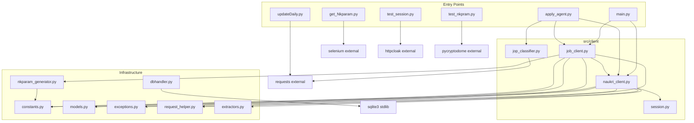
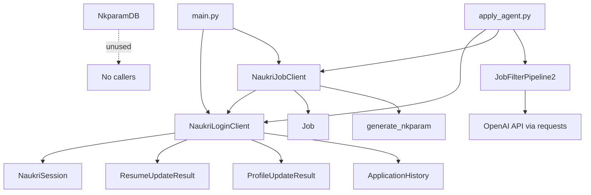
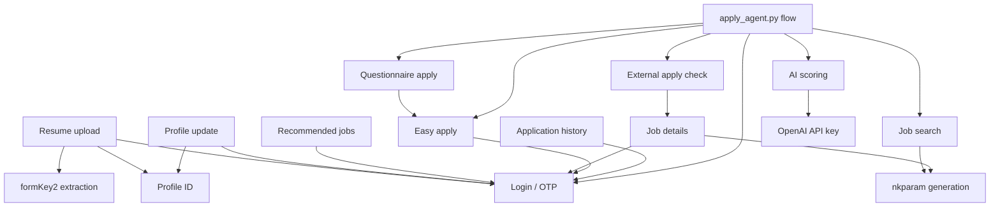
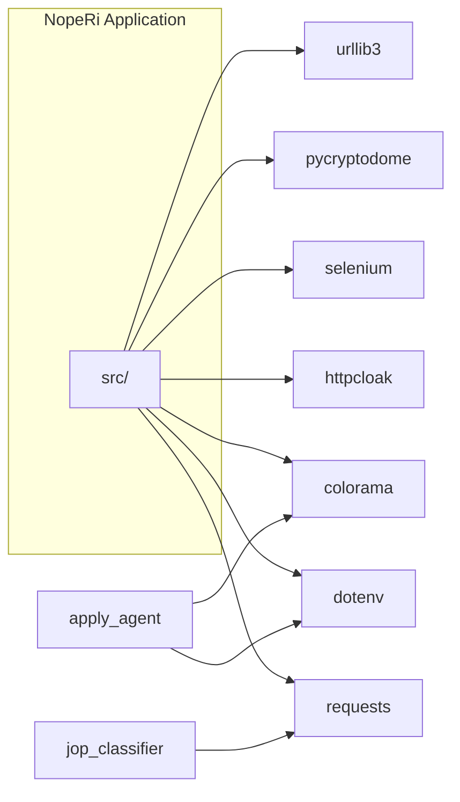

# 06 — Dependency Graph

---

## File Dependency Graph



**Orphan nodes (no incoming edges from production code):** `dbhandler.py`, `get_Nkparam.py`, `test_session.py`, `test_nkpram.py`, `updateDaily.py`

---

## Class Dependency Graph



---

## Feature Dependency Graph



---

## Execution Dependency Graph

Order of operations for **`apply_agent.py`** (critical path):

```
1. load_dotenv
2. NaukriLoginClient.__init__ → build_session()
3. login() → Bearer token
4. NaukriJobClient.__init__ → requires login_client.session
5. search_jobs() × N → requires generate_nkparam()
6. JobFilterPipeline2.run() → requires OPEN_API_KEY
7. is_external_apply() → requires get_job_details() → requires login + nkparam
8. apply_job() → requires login
9. [optional] handle_static_questionnaire_and_apply()
10. save_applied_job() → CSV I/O
```

Order for **`main.py`**:

```
1. load_dotenv
2. login()
3. search_jobs() → nkparam
4. apply_job() per result
```

---

## Import Matrix

| File | Imports From |
|------|--------------|
| `main.py` | `naukri_client`, `job_client`, dotenv, colorama, os, time |
| `apply_agent.py` | `naukri_client`, `job_client`, `jop_classifier`, exceptions, dotenv, colorama, os, time, csv, logging, datetime |
| `naukri_client.py` | `session`, `constants`, `exceptions`, `models`, `extractors`, `requests`, `request_helper` |
| `job_client.py` | `models`, `naukri_client`, `exceptions`, `request_helper`, `nkparam_generator`, `constants`, json, logging, datetime |
| `jop_classifier.py` | json, os, re, requests |
| `session.py` | httpcloak |
| `nkparam_generator.py` | Crypto, base64, time, constants |
| `extractors.py` | re |
| `request_helper.py` | functools, requests, time, random, logging |
| `models.py` | dataclasses, time, typing |
| `constants.py` | re |
| `exceptions.py` | (stdlib only) |
| `dbhandler.py` | sqlite3 |
| `get_Nkparam.py` | selenium, json, time |
| `updateDaily.py` | requests, json, BytesIO, datetime, os, random, re |
| `test_session.py` | httpcloak |
| `test_nkpram.py` | Crypto, base64, time, concurrent.futures |

---

## Reverse Import Matrix (Imported By)

| File | Imported By |
|------|-------------|
| `naukri_client.py` | `main.py`, `apply_agent.py`, `job_client.py` |
| `job_client.py` | `main.py`, `apply_agent.py` |
| `jop_classifier.py` | `apply_agent.py` |
| `session.py` | `naukri_client.py` |
| `constants.py` | `naukri_client.py`, `job_client.py`, `nkparam_generator.py` |
| `models.py` | `naukri_client.py`, `job_client.py` |
| `exceptions.py` | `naukri_client.py`, `job_client.py`, `apply_agent.py` |
| `extractors.py` | `naukri_client.py` |
| `request_helper.py` | `naukri_client.py`, `job_client.py` (unused decorator) |
| `nkparam_generator.py` | `job_client.py` |
| `dbhandler.py` | **None** |
| `get_Nkparam.py` | **None** |
| `updateDaily.py` | **None** |
| `test_*.py` | **None** |

---

## External Package Dependencies



---

## Runtime Data Dependencies

| Artifact | Depends On | Produced By |
|----------|------------|-------------|
| Bearer token | Login response cookies | `login()`, `verify_otp()` |
| formKey | Profile HTML + JS bundles | `get_form_key2()` |
| fileKey | File validation API | `validate_file()` |
| profile_id | Dashboard API | `fetch_profile_id()` |
| nkparam | RSA + timestamp | `generate_nkparam()` |
| Job list | Search/recommend API | `search_jobs()`, `get_recommended_jobs()` |
| AI scores | OpenAI + job metadata | `JobFilterPipeline2.run()` |
| applied_jobs.csv | Successful applies | `save_applied_job()` |
